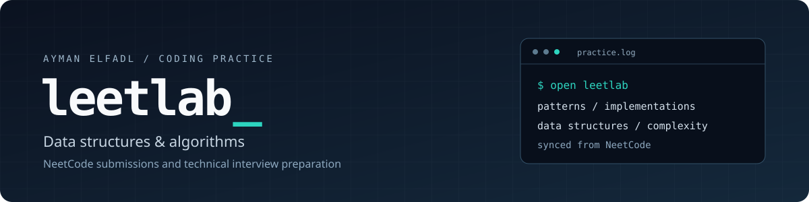

<p align="center">
  
</p>

<p align="center">
  <a href="#practice-log">Practice log</a> ·
  <a href="#solution-index">Solution index</a> ·
  <a href="https://neetcode.io">NeetCode</a> ·
  <a href="https://github.com/aymanelfadl">Ayman Elfadl</a>
</p>

<p align="center">
  
</p>

## What I'm working on

I'm **Ayman Elfadl**, and this is my coding practice lab. I work through data structures and algorithms problems on **NeetCode**, keeping my submissions here as I build my problem-solving foundations and prepare for technical interviews.

My focus is on choosing useful data structures, recognizing recurring patterns, reasoning about time and space complexity, and comparing implementations across languages.

## Practice log

<!-- LEETLAB:START -->

| Problems practiced | Stored submissions | Languages used |
| :---: | :---: | :---: |
| **22** | **24** | **3** |

**Languages:** Python (20) · C++ (3) · Java (1)

**Latest submission:** [Dynamic Array](Data%20Structures%20%26%20Algorithms/dynamicArray/submission-1.java) · Java · 2026-10-13

### Patterns in this lab

| Pattern | Problems |
| --- | ---: |
| Arrays and hashing | 10 |
| Two pointers | 4 |
| Stacks | 5 |
| Binary search | 1 |
| Linked lists | 1 |
| Data structures | 1 |

### Solution index

| Problem | Pattern | Implementations |
| --- | --- | --- |
| [Contains Duplicate](Data%20Structures%20%26%20Algorithms/duplicate-integer) | Arrays and hashing | [C++](Data%20Structures%20%26%20Algorithms/duplicate-integer/submission-0.cpp) |
| [Encode and Decode Strings](Data%20Structures%20%26%20Algorithms/string-encode-and-decode) | Arrays and hashing | [Python](Data%20Structures%20%26%20Algorithms/string-encode-and-decode/submission-0.py) |
| [Group Anagrams](Data%20Structures%20%26%20Algorithms/anagram-groups) | Arrays and hashing | [Python](Data%20Structures%20%26%20Algorithms/anagram-groups/submission-0.py) |
| [Longest Consecutive Sequence](Data%20Structures%20%26%20Algorithms/longest-consecutive-sequence) | Arrays and hashing | [Python](Data%20Structures%20%26%20Algorithms/longest-consecutive-sequence/submission-2.py) |
| [Products of Array Except Self](Data%20Structures%20%26%20Algorithms/products-of-array-discluding-self) | Arrays and hashing | [Python](Data%20Structures%20%26%20Algorithms/products-of-array-discluding-self/submission-0.py) |
| [Special Array I](Data%20Structures%20%26%20Algorithms/special-array-i) | Arrays and hashing | [Python](Data%20Structures%20%26%20Algorithms/special-array-i/submission-6.py) |
| [Top K Frequent Elements](Data%20Structures%20%26%20Algorithms/top-k-elements-in-list) | Arrays and hashing | [C++](Data%20Structures%20%26%20Algorithms/top-k-elements-in-list/submission-0.cpp) |
| [Two Sum](Data%20Structures%20%26%20Algorithms/two-integer-sum) | Arrays and hashing | [Python](Data%20Structures%20%26%20Algorithms/two-integer-sum/submission-0.py) |
| [Valid Anagram](Data%20Structures%20%26%20Algorithms/is-anagram) | Arrays and hashing | [C++](Data%20Structures%20%26%20Algorithms/is-anagram/submission-1.cpp) |
| [Valid Sudoku](Data%20Structures%20%26%20Algorithms/valid-sudoku) | Arrays and hashing | [Python](Data%20Structures%20%26%20Algorithms/valid-sudoku/submission-0.py) |
| [3Sum](Data%20Structures%20%26%20Algorithms/three-integer-sum) | Two pointers | [Python](Data%20Structures%20%26%20Algorithms/three-integer-sum/submission-0.py) |
| [Container With Most Water](Data%20Structures%20%26%20Algorithms/max-water-container) | Two pointers | [Python](Data%20Structures%20%26%20Algorithms/max-water-container/submission-0.py) |
| [Two Sum II](Data%20Structures%20%26%20Algorithms/two-integer-sum-ii) | Two pointers | [Python](Data%20Structures%20%26%20Algorithms/two-integer-sum-ii/submission-0.py) |
| [Valid Palindrome](Data%20Structures%20%26%20Algorithms/is-palindrome) | Two pointers | [Python](Data%20Structures%20%26%20Algorithms/is-palindrome/submission-0.py) |
| [Car Fleet](Data%20Structures%20%26%20Algorithms/car-fleet) | Stacks | [Python](Data%20Structures%20%26%20Algorithms/car-fleet/submission-1.py) |
| [Daily Temperatures](Data%20Structures%20%26%20Algorithms/daily-temperatures) | Stacks | [Python](Data%20Structures%20%26%20Algorithms/daily-temperatures/submission-1.py) |
| [Evaluate Reverse Polish Notation](Data%20Structures%20%26%20Algorithms/evaluate-reverse-polish-notation) | Stacks | [Python](Data%20Structures%20%26%20Algorithms/evaluate-reverse-polish-notation/submission-0.py) |
| [Min Stack](Data%20Structures%20%26%20Algorithms/minimum-stack) | Stacks | [Python](Data%20Structures%20%26%20Algorithms/minimum-stack/submission-0.py) |
| [Valid Parentheses](Data%20Structures%20%26%20Algorithms/validate-parentheses) | Stacks | [Python](Data%20Structures%20%26%20Algorithms/validate-parentheses/submission-0.py) |
| [Binary Search](Data%20Structures%20%26%20Algorithms/binary-search) | Binary search | [Python](Data%20Structures%20%26%20Algorithms/binary-search/submission-0.py) |
| [Reverse Linked List](Data%20Structures%20%26%20Algorithms/reverse-a-linked-list) | Linked lists | [Python](Data%20Structures%20%26%20Algorithms/reverse-a-linked-list/submission-1.py) |
| [Dynamic Array](Data%20Structures%20%26%20Algorithms/dynamicArray) | Data structures | [Java](Data%20Structures%20%26%20Algorithms/dynamicArray/submission-1.java), [Python](Data%20Structures%20%26%20Algorithms/dynamicArray/submission-0.py) |

<!-- LEETLAB:END -->

## How the repository is organized

```text
Data Structures & Algorithms/
└── dynamicArray/
    ├── submission-0.py
    └── submission-1.java
```

Each problem has its own folder. Separate submission files preserve different attempts or implementations, so I can return to a problem and compare approaches.

<details>
<summary><strong>Sync and automatic updates</strong></summary>

Solutions arrive through **NeetCode's GitHub Sync**. Connect or manage it at [neetcode.io/profile/github](https://neetcode.io/profile/github): choose whether to sync accepted submissions or all submissions, enable automatic commits, or bulk-sync previous work. Individual submissions can also be synced or removed from a problem's submission history.

The practice log and solution index refresh after submission files change. They show the files currently stored here; each problem folder counts once and each submission file counts once. The update leaves the introduction and these notes in place.

</details>
